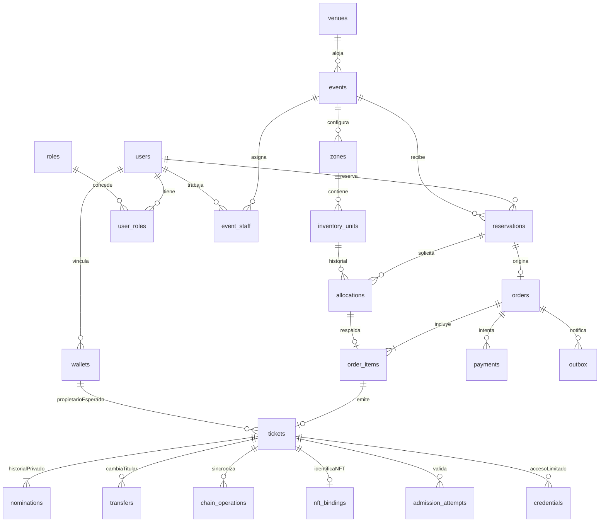

# NexoPass

Plataforma web de boletos digitales nominativos para conciertos, representados mediante NFT y verificables en una blockchain de pruebas.

**Empresa:** Nexo. **Producto:** NexoPass. **Lema provisional:** Tu entrada. Tu experiencia.

Proyecto de graduación de Ingeniería en Sistemas. Este README contiene la especificación inicial acordada del producto. Las funcionalidades descritas son requisitos por implementar, no capacidades ya disponibles ni garantías de seguridad comprobadas.

## Objetivos académicos

### Objetivo general

Crear un prototipo funcional de plataforma web de boletos digitales NFT para eventos que permita su emisión y transferencia mediante un contrato inteligente y su validación mediante códigos QR y consultas a una blockchain de pruebas, verificando su autenticidad, propiedad y estado de uso, así como la trazabilidad de las operaciones.

### Objetivos específicos

1. Proponer los requerimientos funcionales y no funcionales para la emisión, transferencia y validación de boletos digitales mediante blockchain y NFT.
2. Diseñar un contrato inteligente que represente y gestione cada boleto digital como un NFT dentro de una blockchain de pruebas.
3. Construir un módulo que permita la emisión y transferencia de boletos NFT entre los usuarios registrados en la plataforma web.
4. Producir un mecanismo de validación mediante códigos QR que permita verificar la autenticidad, propiedad y estado de uso de los boletos NFT en blockchain.

## Alcance del prototipo

- Catálogo de conciertos, búsqueda, filtros y detalle de cada evento.
- Registro, verificación de correo, inicio de sesión, recuperación de acceso y perfil.
- Recintos, zonas, capacidad y asientos numerados cuando corresponda.
- Compra de varios boletos, asignando un asistente a cada uno.
- Reservas temporales de inventario y pagos simulados mediante tarjeta o criptomonedas.
- Emisión real de NFT en una red de pruebas y seguimiento de transacciones.
- Mis boletos, resumen de compra y notificaciones reales por correo.
- Consulta limitada del boleto para asistentes sin cuenta.
- Transferencias restringidas con aceptación y trazabilidad.
- Panel administrativo, ventas por concierto y control de acceso mediante QR.

No se incluyen cobros reales, despliegue en una blockchain con fondos reales, mercado de reventa ni validación automática de identidad contra registros oficiales. El sistema busca dificultar fraude y reventa no autorizada; no garantiza eliminarlos.

## Roles y permisos

| Rol | Responsabilidades y límites |
| --- | --- |
| Visitante | Consultar cartelera y detalles públicos. |
| Usuario registrado / comprador | Gestionar su perfil, comprar, consultar sus órdenes y boletos e iniciar operaciones autorizadas. |
| Asistente sin cuenta | Recibir y consultar únicamente su boleto mediante acceso protegido; no aceptar transferencias de propiedad sin registrarse. |
| Usuario receptor | Aceptar transferencias con cuenta y correo verificados y billetera asociada. |
| Personal de acceso | Consultar lo necesario para comprobar identidad y validar entradas de los eventos asignados; no emitir ni cambiar titulares. |
| Administrador | Gestionar conciertos, recintos, inventario, permisos y reportes; atender incidencias con auditoría. |

Los roles pueden coexistir en una persona. El acceso administrativo requiere autenticación y asignación explícita del rol; escribir un correo no concede privilegios. El backend comprobará autorización y pertenencia del recurso en cada operación. Se propone segundo factor para administración, sujeto a selección técnica.

## Comprador, asistente y propietario del NFT

Son conceptos distintos:

- **Comprador:** paga la orden simulada y recibe el comprobante general.
- **Asistente autorizado:** persona nominada que podrá entrar mostrando su documento.
- **Propietario del NFT:** dirección de billetera reconocida por el contrato.

Una orden puede incluir varios boletos con asistentes diferentes. Cada boleto tendrá nombre completo, tipo y número de documento y correo del asistente, almacenados de forma privada.

Cuando el asistente no tenga cuenta, el comprador podrá conservar inicialmente el NFT y designar a esa persona como asistente. Recibir un correo no acredita propiedad del NFT. El registro posterior y la posible reclamación del NFT requieren definir un flujo explícito; no se tratarán como una transferencia gratuita adicional por defecto.

## Flujos principales

### Compra y emisión

1. El comprador inicia sesión con correo verificado.
2. Selecciona concierto, zona, cantidad y asientos cuando corresponda.
3. El sistema reserva inventario durante un plazo configurable y visible.
4. Registra los datos de cada asistente y revisa el resumen.
5. El servidor calcula precios y totales; no acepta importes enviados por el navegador como autoridad.
6. Se procesa el pago de demostración.
7. Se solicita la emisión de un NFT por boleto sin duplicar operaciones ante reintentos.
8. Se muestra el estado pendiente hasta confirmar blockchain.
9. Tras confirmar, se habilitan los boletos y se notifican por correo. Un fallo de correo permite reenvío sin volver a cobrar ni emitir.

El pago aprobado no implica emisión confirmada. Si una operación falla, el sistema conserva información suficiente para reconciliarla y evitar liberar inventario ya vendido o aceptar una emisión tardía indebidamente.

### Transferencia

1. Se comprueba que el boleto esté activo, sin uso, dentro del plazo y sin otra operación incompatible.
2. Se solicita autorización al titular actual. Si el asistente designado es distinto del comprador, este último no puede sustituirlo unilateralmente.
3. Para un asistente sin cuenta se usa una autorización enviada a su correo con token seguro, vencimiento y uso único.
4. El receptor se registra o inicia sesión, verifica su correo y acepta los datos de destino.
5. Se ejecuta el cambio autorizado del propietario del NFT.
6. Tras confirmación, se actualiza el asistente autorizado y se invalida la credencial anterior. Durante la transición no se permite acceso ni una segunda transferencia.
7. Se notifica a las partes y se registra la operación.

La invitación puede expirar o cancelarse antes de su aceptación. Una transacción ya enviada no se presenta como cancelada simplemente por cerrar la página.

### Ingreso al concierto

1. El personal autorizado escanea el QR desde su sesión.
2. El sistema comprueba evento, vigencia de credencial, autenticidad del NFT, propietario esperado y estado de uso.
3. El personal compara los datos del asistente con el documento físico. El sistema no realiza reconocimiento facial ni verificación oficial automática.
4. Se solicita el consumo único del boleto en blockchain.
5. Solo después de la confirmación se autoriza el ingreso. Una segunda solicitud no puede autorizar otra entrada.

Consultar un QR o abrir el boleto no consume la entrada. Una página pública nunca mostrará un indicador que sustituya la autorización del personal. Sin conectividad o con confirmación pendiente se informa la incidencia; el prototipo no promete validación sin conexión.

## Reglas de negocio

### Eventos e inventario

- El recinto es reutilizable; la distribución y las zonas habilitadas se configuran por concierto.
- Los nombres Platinum, VIP, general, sol, sombra o gradería son configurables y no implican automáticamente silla asignada.
- Una zona puede ser numerada o de admisión general; se controla asiento único o capacidad, respectivamente.
- Las reservas vencen y liberan inventario cuando sea procedente. La duración exacta se definirá antes de implementar.
- No se permite vender dos veces el mismo asiento ni superar la capacidad mediante compras concurrentes.
- No se permite reducir capacidad o eliminar asientos comprometidos sin un procedimiento explícito.
- Eventos con ventas conservan su historial; cancelar no equivale a borrar.

### Pagos de demostración

- La interfaz identifica que no existen cargos reales y utiliza datos ficticios.
- Tarjeta incluye titular, número, vencimiento y CVV; se acepta formato válido sin autorización bancaria real.
- No se persiste ni registra el número completo ni el CVV.
- Se conservan referencia, método, importe y estado simulado; se contemplan resultados aprobado, rechazado y pendiente para pruebas.
- La opción de criptomonedas no debe aparentar un pago real si no existe tal transacción.
- Confirmar o repetir una solicitud no genera órdenes, pagos ni NFT duplicados.

### Titularidad y transferencias

- Un boleto permite una transferencia, hasta 24 horas antes del inicio del concierto.
- Cambiar de asistente cuenta como transferencia, incluso si no cambia la billetera.
- Las restricciones de plazo, autorización, destino y cantidad deben impedirse también desde rutas externas del contrato, incluidos operadores aprobados.
- Cambiar el perfil o su documento no cambia automáticamente los datos fijados en boletos emitidos.
- Correcciones tipográficas requieren revisión y auditoría; no habilitan sustituir personas de forma encubierta.
- No se transfieren boletos usados, cancelados o correspondientes a eventos finalizados.
- Los límites se mantienen por boleto y no se reinician por cambiar de cuenta o billetera.
- Registrar un correo demuestra control sobre él, no identidad civil.
- La política para menores, documentos admitidos y documentos vencidos queda pendiente de definir antes de implementar la nominación.

### QR, privacidad y acceso

- El QR contiene una credencial opaca, no nombres ni documentos en texto público.
- Se invalida al confirmar un cambio de titular; los reenvíos de correo no cambian titularidad.
- Se muestra el documento parcialmente oculto al usuario; su consulta completa requiere permisos y necesidad operativa.
- Nombres, correos, documentos y datos de tarjeta no se publican en blockchain, metadatos del NFT ni almacenamiento público.
- El diseño de credenciales para asistentes sin cuenta y su renovación se especificará antes de implementar QR; un correo permanente no se considerará prueba de identidad.
- Compartir una captura no otorga por sí solo derecho de entrada. El control documental y el consumo único siguen siendo obligatorios.

## Estados y consistencia

Se utilizarán estados separados, sin convertir toda la compra en un único indicador:

| Entidad | Estados iniciales propuestos |
| --- | --- |
| Evento | Borrador, publicado, cancelado, finalizado; reprogramación conserva historial. |
| Reserva | Activa, consumida, vencida, cancelada. |
| Pago simulado | Pendiente, aprobado, rechazado, reversado de forma simulada. |
| Emisión | Pendiente, enviada, confirmada, fallida. |
| Boleto | Pendiente de emisión, activo, usado, cancelado. |
| Transferencia | Invitada, aceptada, enviada a blockchain, confirmada, rechazada, vencida, cancelada o fallida, según la etapa. |
| Validación | En proceso, confirmada, denegada o fallida. |

El contrato será la autoridad sobre existencia, propietario y uso del NFT. PostgreSQL mantendrá datos privados y proyecciones operativas verificables contra blockchain. Se definirá una política de confirmaciones y reconciliación ante demoras, reintentos o reorganizaciones. Las transiciones tendrán precondiciones y excluirán operaciones incompatibles sobre el mismo boleto.

## Arquitectura propuesta

| Componente | Tecnología o responsabilidad |
| --- | --- |
| Frontend | React con TypeScript; catálogo, compra, perfil, administración y acceso. |
| Backend | Python con FastAPI; API, permisos, reglas y coordinación. |
| Persistencia | PostgreSQL, SQLAlchemy y migraciones con Alembic. |
| Contrato | Solidity, ERC-721 y componentes de OpenZeppelin con restricciones específicas. |
| Red | Blockchain local durante desarrollo; Sepolia para demostración, sujeta a disponibilidad. |
| Billeteras | Incorporadas para usuarios sin extensión; MetaMask opcional. Proveedor pendiente. |
| Correo | Proveedor pendiente; notificaciones reales y reintentos controlados. |
| Pruebas | Reglas del backend, contrato, integración y recorridos completos. |

Se propone un repositorio con frontend, backend y contratos, y un backend modular. No se requieren microservicios. El NFT no necesita contener todos los datos impresos del boleto; la vista compone información privada autorizada y verificaciones de blockchain.

La selección final de billeteras debe resolver quién autoriza transacciones, recuperación, exportación, patrocinio de gas de prueba y límites del proveedor. No se almacenarán claves privadas en texto plano ni se incluirán secretos en el repositorio.

## Requerimientos no funcionales

- Autorización en servidor, mínimo privilegio y separación de funciones.
- Contraseñas con hash especializado; sesiones seguras, límites de intentos y recuperación mediante tokens de vencimiento corto y uso único.
- Validación de entradas, protección contra acceso a recursos ajenos y defensas web según el mecanismo de sesión elegido.
- Operaciones críticas idempotentes, restricciones de unicidad y control de concurrencia.
- Auditoría de cambios de identidad, permisos, emisión, transferencias y acceso sin registrar secretos ni documentos completos en logs.
- Interfaz adaptable a móvil, navegación accesible y mensajes claros para estados pendientes o fallidos.
- Migraciones versionadas, pruebas reproducibles y configuración sensible fuera del código.
- Copias de seguridad y restauración verificables; retención y eliminación de datos por definir.
- Medición de latencia de confirmación e ingreso bajo concurrencia. Los objetivos numéricos se fijarán con el entorno y volumen de demostración; no se promete rendimiento no medido.

## Criterios de aceptación

| ID | Escenario | Resultado esperado |
| --- | --- | --- |
| CA-01 | Registro con correo sin verificar | No puede comprar ni aceptar transferencias hasta verificarlo. |
| CA-02 | Usuario común intenta abrir una operación administrativa | El servidor deniega la operación aunque se invoque la API directamente. |
| CA-03 | Usuario consulta una orden ajena cambiando su identificador | Se deniega sin exponer datos personales. |
| CA-04 | Dos compras simultáneas del mismo asiento o último cupo | Solo una confirma la asignación. |
| CA-05 | Reserva vencida antes de completar compra | No se vende inventario sin volver a comprobar disponibilidad. |
| CA-06 | Compra repetida por doble clic o reintento | Una orden y un NFT por boleto, sin duplicados. |
| CA-07 | Pago rechazado | No se emiten NFT y la reserva se libera conforme a sus reglas. |
| CA-08 | Pago aprobado y emisión pendiente o fallida | Se informa el estado real y no se habilita un boleto no confirmado. |
| CA-09 | Fallo de correo tras emisión | El boleto permanece disponible y el reenvío no repite la emisión. |
| CA-10 | Orden con asistentes distintos | Cada correo recibe únicamente su boleto; comprador recibe resumen general. |
| CA-11 | Cambio de asistente sin mover el NFT | Se aplica la autorización y el límite de transferencia. |
| CA-12 | Transferencia fuera de plazo, repetida o sobre boleto usado | Se rechaza también al intentar operar directamente con el contrato. |
| CA-13 | Transferencia válida confirmada | Nuevo propietario y asistente coherentes; credencial anterior inválida. |
| CA-14 | Cambio del nombre en el perfil | No altera la nominación de un boleto emitido. |
| CA-15 | Dos escaneos concurrentes | Como máximo uno termina autorizado. |
| CA-16 | QR válido pero documento distinto | Se deniega el ingreso y no se consume el boleto por la mera consulta. |
| CA-17 | Sin red o transacción de consumo pendiente | No se comunica ingreso autorizado. |
| CA-18 | QR manipulado, vencido o correspondiente a otro evento | Se rechaza sin revelar datos privados. |
| CA-19 | Personal de acceso intenta emitir o cambiar titular | Se deniega y se conserva evidencia de auditoría pertinente. |
| CA-20 | Inspección de blockchain, metadatos, QR y logs | No aparecen documentos, tarjetas ni secretos en los canales públicos o registros operativos. |

## Incidencias y decisiones pendientes

Antes de implementar los módulos afectados se resolverán:

- Fecha de entrega, entorno de despliegue y volumen esperado para la demostración.
- Cancelación y reprogramación: avisos, bloqueo de entradas y reversos simulados. Una cancelación local no debe dejar un NFT utilizable.
- Recuperación de cuenta, pérdida o compromiso de billetera: revocación y recuperación sin reiniciar límites ni abrir transferencias administrativas irrestrictas.
- Reclamar un NFT para un asistente inicialmente sin cuenta y su efecto en la transferencia permitida.
- Documentos admitidos, menores, correcciones de identidad y solicitudes de soporte.
- Límites de compra, duración de reservas, moneda, cargos y presentación de totales.
- Proveedor de correo y billeteras, custodia efectiva, confirmaciones de blockchain y estrategia para transacciones atascadas.
- Diseño de credenciales QR y protección del acceso por correo.
- Retención de datos, autenticación reforzada y objetivos medibles de rendimiento.

## Plan de construcción

1. Completar esta especificación y convertir los criterios en casos verificables.
2. Diseñar modelo de datos, estados y contrato inteligente en conjunto.
3. Definir API y bocetos de pantallas.
4. Crear estructura, migraciones y verificaciones del proyecto.
5. Implementar un recorrido completo: crear concierto, comprar de forma simulada, emitir NFT, notificar y validar entrada.
6. Incorporar transferencias, administración, reportes y escenarios de incidencia.
7. Ejecutar pruebas de seguridad, concurrencia y recuperación, desplegar el prototipo y reunir evidencia para la defensa.

Se trabajará con tareas pequeñas y ramas correlativas `PG#1`, `PG#2`, `PG#3`, etc. Cada cambio se registra en su rama y se integra localmente en `main` tras verificarlo. El propietario autorizó al asistente a crear ramas, preparar cambios, realizar commits e integrarlos. La publicación remota requiere una instrucción específica.

Formato de los commits:

```text
Tema de lo que se está haciendo

Mejoras/Correcciones/Integraciones:
Descripción breve de lo realizado.
```

## Estado actual

Especificación y modelo relacional inicial con migración Alembic y pruebas de integridad en PostgreSQL. Todavía no hay API, frontend ni contrato desplegado. La creación de la base local requiere autenticación explícita del propietario.

## Referencias técnicas

- [FastAPI](https://fastapi.tiangolo.com/features/).
- [OpenZeppelin Contracts](https://docs.openzeppelin.com/contracts/5.x/).
- [Redes de Ethereum](https://ethereum.org/developers/docs/networks/).
- [OWASP: autorización](https://cheatsheetseries.owasp.org/cheatsheets/Authorization_Cheat_Sheet.html).
- [OWASP: seguridad de lógica de negocio](https://cheatsheetseries.owasp.org/cheatsheets/Business_Logic_Security_Cheat_Sheet.html).
## Diseño inicial de persistencia

El modelo ejecutable se encuentra en `backend/src/nexopass/schema.py`; sus cambios se aplican con Alembic, no creando tablas manualmente. Se utilizan UUID, fechas con zona horaria, importes `NUMERIC(12,2)` y claves foráneas con restricciones explícitas. Las direcciones EVM se almacenan normalizadas en minúsculas; la presentación puede recuperar el formato checksum.



El diagrama expresa las relaciones funcionales. Algunas cardinalidades mínimas, como que una orden tenga al menos una línea, se exigirán al confirmar la operación en el servicio; no todas están garantizadas únicamente por una clave foránea.

### Diccionario de entidades

| Tabla | Responsabilidad |
| --- | --- |
| `users` | Cuenta, nombre de perfil, hash de contraseña, correo normalizado, verificación y desactivación. No sustituye la nominación del boleto. |
| `roles` | Catálogo de roles; no crea automáticamente un administrador. |
| `user_roles` | Asignación explícita de permisos con referencia al otorgante. |
| `wallets` | Dirección, usuario, modalidad y evidencia temporal de vinculación; no guarda claves privadas. |
| `venues` | Recinto, ciudad, dirección y zona horaria de presentación. |
| `events` | Concierto, publicación, horarios de venta y acceso y fecha límite de transferencia. |
| `event_staff` | Personal autorizado para un evento concreto. |
| `zones` | Nombre comercial, modalidad, precio, moneda y beneficios por concierto. |
| `inventory_units` | Una silla numerada o un cupo individual de admisión general. La capacidad total se deriva del inventario; no se mantiene un contador independiente. |
| `reservations` | Comprador, evento, vencimiento y ciclo de reserva. |
| `allocations` | Historial de asignación de unidades a reservas, con una única asignación vigente por unidad. |
| `orders` | Orden, comprador, reserva, total, moneda y clave de idempotencia. |
| `order_items` | Una entrada de la orden con asignación de inventario y precio fijado al comprar. |
| `payments` | Intentos simulados y referencia de operación; sin PAN, CVV ni campos genéricos de datos de tarjeta. |
| `tickets` | Boleto lógico, versión de nominación vigente, propietario esperado, uso y contadores. |
| `nominations` | Historial del asistente separado del perfil; documento cifrado, últimos cuatro caracteres y versión de clave. |
| `transfers` | Invitación, receptor y autorizaciones del propietario y asistente, además de aceptación y estado. |
| `chain_operations` | Solicitud idempotente, red, contrato, transacción y bloque confirmado; puede registrar un estado huérfano tras reorganización. |
| `nft_bindings` | Relación única entre boleto y NFT: red, contrato y token uint256. |
| `credentials` | Hash de tokens de verificación, recuperación, consulta, QR o autorización; alcance, vencimiento, uso y revocación. |
| `admission_attempts` | Comprobación presencial, personal asignado, versiones consultadas y operación de consumo del mismo boleto. |
| `outbox` | Trabajo de notificación persistido en la transacción de negocio; referencias internas, sin enlaces secretos en claro. |
| `audit_entries` | Registro de acciones con identificador de solicitud y detalles permitidos; no documentos ni credenciales. |

El cifrado de documentos y la emisión de tokens aún no están implementados. Guardar bytes o un campo llamado hash no constituye por sí solo protección: el servicio deberá usar cifrado autenticado con claves fuera de la base y tokens aleatorios de alta entropía cuyo hash SHA-256 sea lo persistido.

### Restricciones y responsabilidades

PostgreSQL protege inicialmente:

- Una única asignación `held` o `committed` por unidad de inventario, incluyendo compras concurrentes.
- Consistencia de evento, reserva y comprador mediante claves foráneas compuestas.
- Una orden por reserva, una línea por asignación y un boleto por línea.
- Un único intento de pago pendiente o aprobado por orden.
- Existencia de la nominación vigente al confirmar la transacción; la clave foránea diferida permite crear boleto y nominación juntos.
- Contador de transferencia entre cero y uno; una transferencia viva o confirmada por boleto.
- Una operación de blockchain en curso por boleto y una emisión confirmada por boleto.
- Un intento de ingreso pendiente o confirmado por boleto y una referencia a una operación de consumo del mismo boleto.
- Identidad declarada coincidente antes de registrar una validación pendiente o confirmada.

Los futuros servicios deben validar permisos, firmas y pertenencia de billeteras; calcular el total desde las líneas; comprobar correo verificado, publicación y fechas; bloquear unidades deshabilitadas; comparar versiones de credenciales; verificar recibos reales de blockchain y aplicar transiciones monotónicas. Las restricciones estructurales no sustituyen esas comprobaciones.

La base no impide por sí sola que un usuario con permisos SQL amplios altere una autorización o un contador. La aplicación no utilizará el rol de migración: el rol de ejecución se provisionará con mínimo privilegio cuando exista el backend. La auditoría requerirá permisos que impidan su edición al rol normal.

### Reserva y compra bajo concurrencia

1. Seleccionar unidades habilitadas y bloquearlas dentro de una transacción corta. Para admisión general se puede usar `FOR UPDATE SKIP LOCKED`.
2. Verificar disponibilidad y precio del servidor; crear reserva y asignaciones. La unicidad parcial resuelve colisiones residuales.
3. No llamar a correo, blockchain ni proveedores mientras se mantienen bloqueos de inventario.
4. Al aprobar el pago simulado, bloquear la reserva y comprobar vencimiento. En la misma transacción fijar líneas, comprometer inventario y registrar el trabajo de emisión.
5. Una asignación comprometida no vence por el temporizador de reservas ni se libera porque una emisión esté pendiente.
6. Un proceso de expiración bloquea la reserva y libera únicamente asignaciones retenidas que sigan siendo elegibles. Se usa el reloj de PostgreSQL y un orden consistente de bloqueo.
7. Los reintentos conservan la clave de idempotencia y comparan el contenido original; reutilizar una clave con otra selección se rechaza.

Cambiar el inventario disponible después de publicar requiere un servicio auditado. La capacidad de la base no basta para impedir sobreemisión mediante llamadas directas al contrato; este tendrá también su propio inventario autorizado.

## Diseño inicial del contrato inteligente

Esta sección especifica el contrato; todavía no hay Solidity implementado ni desplegado.

### Datos públicos mínimos

- Identificador aleatorio del evento y referencia opaca única del boleto, sin derivarlos del nombre o documento.
- Propietario EVM, token ID, evento e identificador opaco de unidad de inventario.
- Estado del evento, horarios permitidos, nominación/credencial como números de versión y contador de transferencia.
- Estado de uso o cancelación y operaciones ya ejecutadas para impedir repeticiones.

No se publican hashes simples de documentos: esos valores pueden adivinarse por enumeración y vincular identidades. Ni los metadatos ni `tokenURI` contendrán datos personales.

### Operaciones previstas

| Operación conceptual | Autorización y efecto |
| --- | --- |
| Configurar evento e inventario | Rol gestor; registra unidades únicas y capacidad antes de emitir, con cambios restringidos después de ventas. |
| Emitir boleto | Rol emisor; referencia y unidad únicas, destino válido, evento permitido y operación no ejecutada. |
| Transferir de forma autorizada | Consentimiento del propietario y autorización de política emitida tras comprobar al asistente y receptor; una vez y antes del límite. Incrementa versiones y contador incluso si conserva la dirección. |
| Consumir boleto | Rol validador limitado al evento; propietario y versión esperados, ventana de ingreso vigente y boleto activo. El cambio a usado es indivisible. |
| Cancelar evento o boleto | Rol expresamente autorizado; bloquea el uso sin borrar historial ni reemitir el mismo inventario de forma accidental. |
| Consultar estado | Lectura pública limitada a datos no personales. |

Las firmas de autorización vincularán red, contrato, operación, boleto, propietario esperado, destino, versión, nonce y vencimiento para impedir reutilización y cambio de destinatario. Los detalles de EIP-712 y compatibilidad de firmas de billeteras se cerrarán al seleccionar proveedor.

Las rutas ERC-721 ordinarias (`transferFrom`, variantes de `safeTransferFrom` y operadores aprobados) no permitirán movimientos que eviten estas reglas. La validación central se aplicará en `_update`; la ruta autorizada estará protegida contra reentrada. Tampoco habrá una función pública de cambio de nombre que eluda el contador.

El contrato no puede leer correos, comprobar documentos físicos ni saber si una persona pagó por fuera. Confía en los roles y autorizaciones de la plataforma para esas comprobaciones; esa dependencia debe explicarse en la defensa académica. Las claves de emisor, gestor y validador no se incluyen en el frontend.

### Sincronización y recuperación

- El backend persiste una intención antes de enviar la transacción. Un trabajador conserva su identificador lógico durante reintentos.
- Un timeout no equivale a fallo definitivo. Se consulta recibo y estado contractual antes de reenviar.
- La confirmación comprueba red, contrato, evento emitido y valores esperados, no solo un hash de transacción.
- Solo se habilita entrada tras la confirmación requerida. La proyección SQL se actualiza junto con las notificaciones pendientes.
- Una transferencia y un consumo compiten sobre el mismo estado contractual; un permiso firmado con versión antigua no podrá usarse después del otro.
- Reorganizaciones obligan a reconciliar; se suspende la autorización afectada hasta recuperar certeza. Si la persona ya entró, se registra la incidencia: no se puede revertir físicamente el ingreso.
- El número de confirmaciones se configura por red y se medirá frente a la latencia de ingreso; no existe finalidad instantánea garantizada.
- Recuperar una billetera no tendrá una ruta administrativa irrestricta. Hasta diseñar y probar revocación y recuperación, se tratará como incidencia sin movimientos automáticos. No se reinician nominación ni contador.

## Preparación y verificación del backend

Requiere Python 3.13 o posterior y PostgreSQL. Desde `backend`, crear un entorno virtual fuera del repositorio e instalar las dependencias declaradas:

```powershell
python -m venv "$env:USERPROFILE\NexoPassTools\venv"
& "$env:USERPROFILE\NexoPassTools\venv\Scripts\python.exe" -m pip install -e '.[test]'
```

Las migraciones toman `NEXOPASS_DATABASE_URL` del entorno; no hay contraseña predeterminada, archivo de secretos ni conexión implícita al usuario `postgres`. Para evitar escribir la contraseña en historial, el script de preparación local solicita credenciales ocultas directamente en la terminal:

```powershell
& "$env:USERPROFILE\NexoPassTools\venv\Scripts\python.exe" -B scripts\prepare_database.py
```

El script crea la base `nexopass` y el rol `nexopass_migrator` si no existen, sin modificar contraseñas existentes. Aplica la migración inicial con ese rol y verifica diferencias contra el modelo. No crea administradores de la plataforma, usuarios ficticios ni billeteras.

Las pruebas requieren una base PostgreSQL aislada ya migrada, cuyo nombre empiece con `nexopass_test_`, indicada mediante `NEXOPASS_TEST_DATABASE_URL`. No ejecutarlas contra la base de desarrollo:

```powershell
python -B -m pytest -q
```

Cubren integridad, aislamiento entre eventos, nominación obligatoria, autorizaciones estructurales y competencia real entre conexiones por un asiento o cupo. No acreditan todavía seguridad de la API, entrega de correo, firma de billeteras ni comportamiento de un contrato desplegado.
### Validación realizada sobre PostgreSQL 18.6

- 17 pruebas de integridad aprobadas, incluyendo competencia entre conexiones por asiento numerado y cupo general.
- Migración `0001`: aplicación, reversión y reaplicación correctas; Alembic no detecta diferencias frente al modelo.
- Preparación local probada en una instancia aislada: creación de base/rol, reejecución y rechazo de contraseña incorrecta sin cambiar la existente.
- Las instancias temporales usan autenticación SCRAM y no modifican el servicio local del puerto 5432.
- El servidor local está disponible; la aplicación de la migración a su base definitiva requiere que el propietario introduzca las credenciales en el script interactivo.

En este equipo se preparó el entorno en `C:\Users\jamdj\NexoPassTools\venv`. Desde PowerShell se puede ejecutar directamente:

```powershell
& 'C:\Users\jamdj\NexoPassTools\venv\Scripts\python.exe' -B 'C:\Users\jamdj\Downloads\Proyecto de graduacion\ProyectoGraduacion\backend\scripts\prepare_database.py'
```
## Referencias de imágenes

La migración `0002` amplía el modelo sin modificar la migración inicial:

| Entidad | Campo | Uso |
| --- | --- | --- |
| Usuario | `users.avatar_url` | Foto de perfil opcional. |
| Concierto | `events.poster_url` | Cartelera o póster; campo existente desde `0001`. |
| Recinto | `venues.image_url` | Fotografía del recinto. |
| Recinto | `venues.seating_map_url` | Plano de referencia del recinto. |
| Zona | `zones.image_url` | Imagen de ubicación o beneficios. |

Los campos son opcionales y guardan referencias; no se almacenan archivos binarios en estas columnas. El plano del recinto es una referencia visual y no sustituye el inventario ni determina la distribución de cada concierto.

Todavía no existe carga de archivos. La futura API deberá comprobar permisos, tamaño, contenido y formato de imagen, asignar nombres seguros y coordinar almacenamiento y eliminación. No debe descargar URLs arbitrarias proporcionadas por usuarios.

La revisión `0002` quedó aplicada en la base local `nexopass`. Se verificaron valores nulos para registros previos, escritura y lectura de referencias, conservación de los datos existentes, reversión y reaplicación en una base aislada, ausencia de diferencias con el modelo y las 17 pruebas de integridad existentes.
## Disponibilidad para el mapa interactivo

La migración `0003` agrega posiciones opcionales `map_x` y `map_y` a zonas y unidades de inventario, normalizadas entre 0 y 1 con origen en la esquina superior izquierda del plano. Ambas coordenadas deben estar presentes o ausentes. `zones.display_order` permite ordenar zonas sin depender de su nombre comercial. No se han cargado planos ni coordenadas ficticias en la base local.

Las posiciones son puntos de referencia para zonas y centros de asientos, no polígonos que delimiten áreas. El futuro editor podrá asignarlas sobre el plano apropiado al evento; no se deducen automáticamente desde una imagen. Si no están configuradas, el frontend podrá usar un listado o distribución automática sin inventar ubicaciones físicas.

`backend/src/nexopass/availability.py` contiene las consultas que consumirá la futura API:

- `get_event_availability(connection, event_id)`: datos básicos del evento y resumen por zona con capacidad configurada, disponibles, reservados, vendidos, bloqueados, precio, moneda, imagen y posición.
- `get_zone_seats(connection, event_id, zone_id)`: asientos numerados con unidad, fila, número, posición, estado y posibilidad de selección. No devuelve sillas ficticias para admisión general.

| Estado | Presentación prevista | Condición |
| --- | --- | --- |
| `available` | Verde, etiqueta Libre | Unidad habilitada sin asignación retenida ni comprometida. |
| `reserved` | Amarillo, etiqueta Reservado | Asignación `held`, no seleccionable por otro comprador. |
| `sold` | Rojo, etiqueta Vendido | Asignación `committed`, incluso si la emisión del NFT está pendiente. |
| `blocked` | Gris, etiqueta No disponible | Unidad deshabilitada sin asignación vigente. |

Los colores pertenecen a la presentación, no se persisten como estado de negocio. Se acompañarán con texto o símbolos para no depender únicamente del color. Una zona con ocupación parcial mostrará cantidades, no se marcará completa como vendida por tener un asiento ocupado. Las zonas generales se seleccionarán por cantidad.

Las asignaciones liberadas no afectan la disponibilidad. Una reserva vencida se mantiene visualmente retenida hasta que el proceso de expiración libere su asignación. Las asignaciones existentes tienen prioridad visual sobre una deshabilitación posterior, conservando la distinción entre reserva y venta.

`can_select` exige disponibilidad y evento publicado dentro del horario de venta. Un concierto cancelado, finalizado o todavía en borrador nunca habilita selección, aunque conserve inventario libre. Estas consultas no publican nombres, documentos, correos ni identificadores de reserva.

La lectura del mapa no reserva un asiento: la compra deberá revalidar y bloquear inventario. La actualización automática de la pantalla, zoom, selección, leyenda y navegación accesible quedan para la API y el frontend; todavía no hay endpoints ni interfaz implementados.

Verificación: 32 pruebas aprobadas en PostgreSQL, incluyendo estados mixtos, liberación de reservas, inventario general, aislamiento entre conciertos, venta cerrada, posiciones válidas y reservas vencidas. La migración se aplicó, revirtió y reaplicó en una base aislada; posteriormente se aplicó a `nexopass`, conservando registros y sin diferencias con el modelo.
