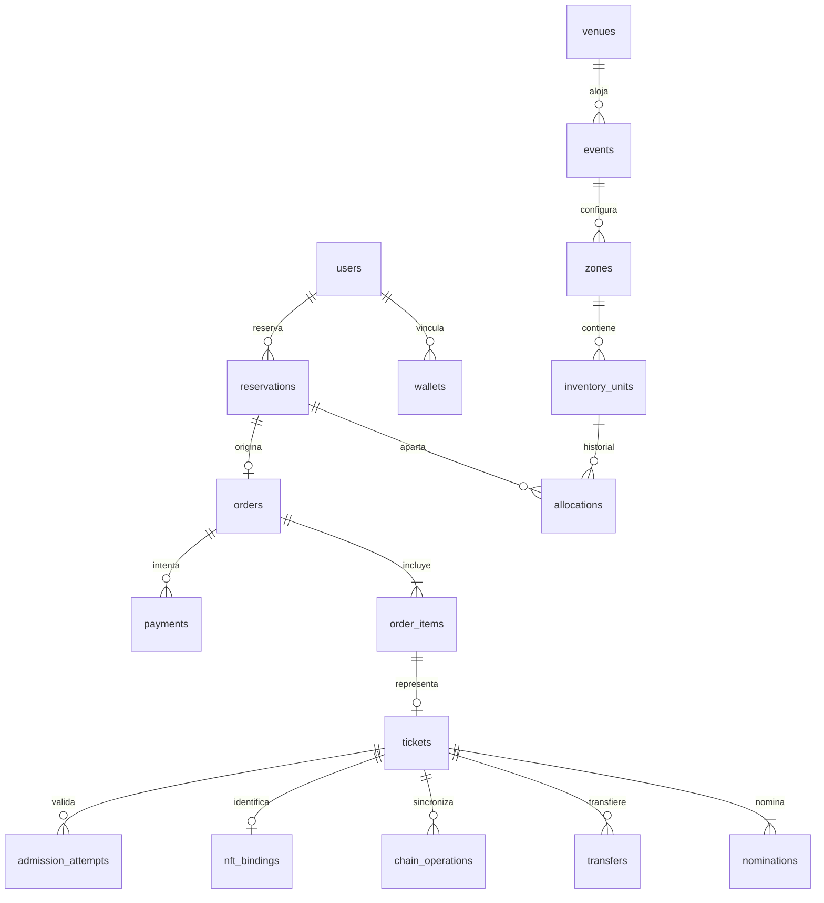

# NexoPass

**Tu entrada. Tu experiencia.** Plataforma web de boletos digitales nominativos para conciertos, representados como NFT verificables en una blockchain de pruebas.

Empresa: **Nexo**. Producto: **NexoPass**. Proyecto de graduación de Ingeniería en Sistemas.

El prototipo funciona localmente con React, FastAPI, PostgreSQL y una cadena EVM persistente. Los pagos son simulados; la emisión, transferencia y consumo del NFT sí ejecutan transacciones reales en la red de pruebas. No se utilizan fondos reales.

## Estado de la entrega

| Módulo | Estado |
| --- | --- |
| Registro, sesiones, verificación y recuperación | Implementados con Argon2, cookies HttpOnly, CSRF y tokens de uso único. |
| Perfil y fotografía | Implementados. Cambiar el perfil no cambia los boletos emitidos. |
| Cartelera y detalle | Implementados con búsqueda, ciudad y disponibilidad por zona. |
| Recintos, conciertos, zonas y personal | Panel administrativo con permisos comprobados en servidor. |
| Asientos y cupos generales | Reserva temporal, numeración, selección, zoom y actualización periódica. |
| Compra con tarjeta o cripto | Simulada, con resultados aprobado, rechazado y pendiente. |
| NFT, transferencia y uso único | Contrato ERC-721 restringido y trabajador de confirmación EVM. |
| QR y control de acceso | Credencial temporal, comparación de documento y autorización tras confirmación. |
| Imágenes | Carga JPEG/PNG/WebP, límites y recodificación sin metadatos. |
| Correo | Bandeja privada local y adaptador SMTP configurable con TLS y reintentos. |
| Reportes y auditoría | Ventas por concierto y moneda; auditoría sin permiso de modificación para la aplicación. |
| Preparación, ejecución y respaldo | Asistentes locales, restauración a una base nueva y suite reproducible. |

El envío por Internet **no está configurado con una cuenta real**, y el contrato **no se ha desplegado en Sepolia**. Ambas opciones requieren credenciales propias. La demostración validada utiliza correo local privado y una cadena EVM local. La cámara QR está implementada; las pruebas de ingreso verificaron el código manual y el backend, no una cámara física.

## Objetivos académicos

### Objetivo general

Crear un prototipo funcional de plataforma web de boletos digitales NFT para eventos que permita su emisión y transferencia mediante un contrato inteligente y su validación mediante códigos QR y consultas a una blockchain de pruebas, verificando su autenticidad, propiedad y estado de uso, así como la trazabilidad de las operaciones.

### Objetivos específicos

1. Proponer los requerimientos funcionales y no funcionales para la emisión, transferencia y validación de boletos digitales mediante blockchain y NFT.
2. Diseñar un contrato inteligente que represente y gestione cada boleto digital como un NFT dentro de una blockchain de pruebas.
3. Construir un módulo que permita la emisión y transferencia de boletos NFT entre los usuarios registrados en la plataforma web.
4. Producir un mecanismo de validación mediante códigos QR que permita verificar la autenticidad, propiedad y estado de uso de los boletos NFT en blockchain.

## Ejecución local en Windows

Requisitos: PostgreSQL 18 en `127.0.0.1:5432`, Python 3.13 o posterior y Node.js LTS compatible con Vite (22.12 o posterior). En el equipo de desarrollo quedaron preparados el entorno `NexoPassTools/venv` y Node.js. Los asistentes no trabajan con repositorios de la empresa.

### Primera preparación

Ejecutar `preparar.cmd` desde la carpeta del proyecto. El asistente:

1. Prepara las dependencias Python del archivo bloqueado y compila frontend y contrato con sus `package-lock.json`.
2. Solicita de forma oculta las contraseñas de PostgreSQL, migrador y aplicación.
3. Aplica las migraciones y los permisos explícitos de los módulos.
4. Solicita el correo y una contraseña independiente para el administrador de NexoPass.
5. Ofrece crear una cartelera ficticia marcada `[DEMO]`, sin ventas ni NFT inventados.

No se cambia la contraseña de una cuenta administrativa existente. Tampoco se convierte automáticamente una cuenta normal en administrador. La contraseña de la plataforma debe tener al menos diez caracteres y no tiene que coincidir con las de PostgreSQL o el correo.

### Iniciar

Ejecutar `iniciar.cmd`. Solicita únicamente los secretos de ejecución que falten, inicia la cadena local y sirve la web y la API en `http://127.0.0.1:8000`. Abre el navegador y se detiene con `Ctrl+C`; la cadena iniciada por el asistente se cierra ordenadamente.

Un puerto ocupado no provoca que se mate o reconfigure otro servicio. Puede elegirse otro puerto web con `iniciar.cmd --port 8001`. Si se interrumpió el proceso de forma abrupta, la marca `NexoPassData/app.lock` exige comprobar que la aplicación esté detenida antes de retirarla.

El primer concierto `[DEMO]` tiene el horario de ingreso abierto y está pensado para probar la entrada. Los otros permiten demostrar transferencias antes de su fecha límite. Son ejemplos ficticios, no eventos ofrecidos al público. La preparación no duplica la cartelera si ya existe.

### Cuentas y correo de demostración

El administrador se crea expresamente durante la preparación. Los clientes se registran desde la web, inician sesión y verifican su correo mediante la bandeja local privada, accesible desde el perfil. Se puede asignar como personal de acceso a otro usuario ya verificado.

La recuperación de una contraseña realmente olvidada requiere recibir su enlace por un canal de correo accesible. Sin SMTP, la bandeja de demostración requiere una sesión iniciada; no existe un buzón público que permita recuperar cuentas ajenas.

## Roles y límites

| Rol | Permisos |
| --- | --- |
| Visitante | Consultar conciertos publicados y disponibilidad. |
| Usuario registrado | Gestionar su cuenta; consultar sus órdenes, boletos y correo local. |
| Usuario verificado | Reservar, comprar y aceptar transferencias. |
| Asistente sin cuenta | Abrir únicamente el boleto recibido mediante un enlace protegido y obtener su QR vigente. |
| Personal de acceso | Consultar identidad y validar boletos de los conciertos asignados. |
| Administrador | Gestionar cartelera, recintos, zonas, imágenes, usuarios, personal, reportes y cancelaciones. |

Ingresar un correo no concede acceso administrativo. Los permisos se comprueban en el backend y no dependen de botones ocultos en React. El usuario SQL de la aplicación no es el propietario de la base ni un administrador de PostgreSQL.

## Reglas del boleto y de compra

### Comprador, asistente y propietario

- El **comprador** paga una orden y recibe el comprobante general.
- El **asistente** queda nominado con nombre, documento y correo por boleto.
- El **propietario del NFT** es la dirección registrada en el contrato.

El comprador puede adquirir entradas para terceros sin cuenta. En ese caso conserva inicialmente el NFT, pero el derecho de asistir queda asignado a la persona nominada. Reenviar un correo no cambia la propiedad ni el nombre autorizado.

El prototipo crea billeteras **custodiadas por el servidor**: sus claves privadas se cifran con una clave de instalación externa al repositorio. No son billeteras de autocustodia ni una integración con MetaMask. La custodia y las comprobaciones de identidad fuera de cadena forman parte del modelo de confianza de la plataforma.

### Inventario, reservas y precios

- Las zonas comerciales son configurables: Platinum, VIP, general, sol, sombra, gradería u otros nombres.
- Cada zona tiene asientos numerados o cupos de admisión general. El nombre VIP no implica por sí solo una silla.
- Cada silla o cupo tiene una unidad de inventario única.
- La reserva dura diez minutos. Una reserva vencida no aparece libre hasta que su asignación se libera de forma transaccional.
- El límite inicial es de seis boletos reservados o comprados por cuenta y concierto. No evita que alguien cree múltiples cuentas.
- La reserva y el compromiso de inventario se coordinan mediante bloqueos y restricciones de unicidad.
- La compra recalcula el importe en servidor y compara el total presentado al cliente. Un cambio de precio requiere revisar una nueva reserva.
- Los reintentos con la misma clave de operación conservan la orden; reutilizarla con otros asistentes o importe se rechaza.
- No se bloquean asientos ya reservados o vendidos. No se elimina una zona con historial.

### Estados del mapa

| Estado | Color previsto | Significado |
| --- | --- | --- |
| Libre | Verde | Lugar habilitado y sin asignación vigente. |
| Reservado | Amarillo | Apartado temporalmente durante la compra. |
| Vendido | Rojo | Inventario comprometido, aunque el NFT todavía se esté emitiendo. |
| Bloqueado | Gris | Fuera de venta por decisión administrativa. |
| Seleccionado | Acento claro | Selección provisional de este navegador; aún no constituye una reserva. |

Los estados se acompañan de texto y etiquetas accesibles. La vista es una fotografía actualizada periódicamente: la compra siempre revalida. Las zonas generales muestran capacidad, no sillas ficticias. Las coordenadas opcionales son puntos normalizados; no existe un editor de polígonos o planos arquitectónicos.

### Pagos de demostración

La tarjeta solicita datos ficticios con formato válido, sin autorización bancaria real. No se guardan PAN, CVV ni la contraseña del correo. El pago cripto también es simulado y no transfiere fondos. La emisión del NFT sí espera una confirmación real de EVM.

Un pago rechazado libera inventario sin emitir. Uno pendiente puede resolverse desde Mis compras antes del vencimiento. Cancelar o vencer una reserva pendiente cancela también su orden y los boletos no emitidos. Un pago aprobado no equivale a NFT confirmado.

## Transferencias

1. Se admite una transferencia por boleto hasta 24 horas antes del inicio.
2. Cambiar de asistente cuenta como transferencia, incluso conservando una dirección de billetera.
3. Se requiere autorización del propietario. Si el asistente es otra persona, recibe un enlace de autorización de uso único.
4. El receptor inicia sesión con correo verificado y completa sus datos de nominación.
5. El propietario firma la operación mediante su billetera custodiada; la firma vincula red, contrato, boleto, destino, versión, nonce y vencimiento.
6. La nueva titularidad y el QR se habilitan tras confirmación. Los accesos anteriores se revocan.

Las invitaciones pueden expirar o cancelarse antes de aceptarse. No se puede cancelar como si nunca hubiera existido una transacción ya enviada. El contrato impide transferencias directas o por operadores aprobados que eludan el límite. Las aprobaciones ERC-721 ordinarias están deshabilitadas.

No existe mercado de reventa. Tampoco se garantiza eliminar pagos por fuera de la plataforma. El nombre y documento aportados en la compra no constituyen una identidad verificada hasta el control presencial.

## Control de acceso

- El QR contiene un token aleatorio, no datos personales. Dura 60 segundos y se renueva desde el boleto.
- El lector verifica su vigencia, evento, nominación, estado y permisos del personal.
- Consultar el QR no consume la entrada. El personal compara nombre y documento original.
- Con identidad diferente, se registra el rechazo sin consumir el NFT.
- La confirmación crea una operación pendiente. Solo se comunica entrada autorizada tras el consumo confirmado en blockchain.
- Dos solicitudes simultáneas no pueden autorizar dos ingresos.
- Un cambio de titular, uso, cancelación o suspensión invalida el acceso anterior.
- Sin red o con confirmación pendiente no se autoriza ingreso. No existe modo de acceso sin conexión.

La cámara necesita permiso del navegador y un contexto seguro; localhost es apto. También se ofrece lectura manual del código. La comparación de identidad es humana: no hay biometría ni consulta de registros oficiales. Menores, documentos vencidos, correcciones de identidad y reprogramaciones con ventas requieren revisión del organizador y no tienen una ruta automática que sustituya asistentes sin autorización.

## Blockchain y consistencia

El contrato conserva referencias opacas de evento y unidad, propietario, versión, contador, uso y cancelación. Los nombres, documentos, correos y QR nunca se publican en la cadena ni en los metadatos públicos.

Solo se admiten la cadena local `31337` y Sepolia `11155111`. El adaptador rechaza redes de dinero real. Ganache escucha en loopback, conserva sus datos fuera del repositorio y utiliza cuentas locales de desarrollo. No deben recibir fondos reales.

El trabajador persiste intenciones, registra los hashes enviados, consulta recibos y compara red, contrato y estado esperado. Puede recuperar una emisión o consumo ya ejecutados después de un reinicio. La cadena local confirma inmediatamente; Sepolia exige seis confirmaciones. Un timeout no se interpreta como un éxito ni como fallo definitivo.

Se comprueba la canonicidad de las últimas 50 operaciones confirmadas. Si se detecta una reorganización, el boleto se suspende y queda evidencia de auditoría. La recuperación compleja, las claves comprometidas y reorganizaciones profundas requieren investigación manual; no existe una reasignación administrativa ilimitada que reinicie contadores. No es posible revertir físicamente un ingreso ya realizado.

El contrato confía en el operador para emisión, validación documental y cancelación. Blockchain garantiza las reglas ejecutadas por ese contrato, no la honestidad de toda la infraestructura. Se requieren auditorías y operación adicional antes de un uso comercial.

## Correo externo y contacto

Contacto del proyecto: **nexopass@proton.me**. No se ha almacenado su contraseña.

El correo gratuito de Proton sirve como contacto, pero no ofrece SMTP directo convencional para esta integración. Su SMTP directo requiere un plan pago y dominio propio; Bridge requiere plan pago. Ver [SMTP de Proton](https://proton.me/support/smtp-submission) y [compatibilidad IMAP/SMTP](https://proton.me/support/imap-smtp-and-pop3-setup).

El adaptador admite un servicio SMTP compatible con STARTTLS y credenciales específicas de aplicación. No se envían mensajes reales durante las pruebas automatizadas. Los mensajes pendientes y sus cuerpos cifrados se conservan para reintento; SMTP no garantiza entrega exactamente una vez.

En producción, si falta el envío de correo o la clave de cifrado, las operaciones afectadas fallan sin simular entregas correctas. La bandeja local no se expone en producción.

## Configuración

Variables opcionales con prefijo `NEXOPASS_`, introducidas en el entorno del proceso. Los asistentes solicitan los secretos ausentes sin guardarlos en archivos.

| Variable | Uso |
| --- | --- |
| `ENVIRONMENT` | `development`, `test` o `production`; documentación disponible solo en desarrollo. |
| `DATABASE_HOST`, `DATABASE_PORT`, `DATABASE_NAME` | Por defecto `127.0.0.1`, `5432`, `nexopass`. |
| `DATABASE_USER` | Solo `nexopass_app`. |
| `DATABASE_PASSWORD` | Contraseña de ejecución, sin valor predeterminado. |
| `DATA_DIRECTORY` | Por defecto `%USERPROFILE%/NexoPassData`. |
| `PUBLIC_URL` | URL de enlaces de correo; el asistente adapta el puerto local si no se indicó otra. |
| `ENCRYPTION_KEY` | Clave Fernet externa; obligatoria en producción. En desarrollo se crea `master.key` local. |
| `SMTP_HOST`, `SMTP_PORT`, `SMTP_USER`, `SMTP_PASSWORD`, `SMTP_SENDER`, `SMTP_STARTTLS` | Envío externo; por defecto no configurado. |
| `CHAIN_RPC_URL`, `CHAIN_ID`, `CONTRACT_ADDRESS`, `RELAYER_KEY` | Red y contrato; la clave del relayer solo se necesita para la red externa. |
| `WORKER_ENABLED` | Activa expiración, correo y confirmación de blockchain. |

Los nombres de la tabla deben llevar el prefijo: por ejemplo, `NEXOPASS_DATABASE_NAME`. No se cargan secretos implícitamente desde el repositorio. Las APIs públicas de salud solo devuelven `ok`, `ready` o `not_ready` y nunca exponen contraseñas, hosts o consultas.

## Arquitectura y archivos

```text
backend/
  src/nexopass/       API, reglas, seguridad, consultas y trabajador
  migrations/        Revisiones Alembic 0001 a 0005
  tests/             Pruebas de PostgreSQL, permisos, API, EVM y recuperación
  scripts/           Preparación de base/rol y respaldo/restauración
  requirements.lock  Dependencias Python verificadas
contracts/
  src/NexoPass.sol    Contrato ERC-721 restringido
  compile.mjs        Compilación reproducible
  chain.mjs          Cadena local persistente
  tests/             Pruebas del contrato
frontend/
  src/pages/         Cartelera, cuentas, boletos, administración y acceso
  src/style.css      Diseño adaptable y estados accesibles
scripts/
  local.py           Preparación, compilación y arranque
  test.py            Suite completa sobre servicios desechables
preparar.cmd
iniciar.cmd
```

PostgreSQL almacena 26 tablas: cuentas y roles, billeteras cifradas, eventos e inventario, reservas, órdenes y pagos, boletos y nominaciones, transferencias, operaciones de cadena, accesos, credenciales, correo, límites y auditoría. Las migraciones no se ejecutan desde la API.



El diagrama expresa relaciones funcionales; las precondiciones de cada transición también se comprueban en los servicios. Importes `NUMERIC`, UUID, fechas con zona horaria y claves foráneas compuestas protegen la consistencia. Los token ID se entregan como texto para no perder precisión en JavaScript.

### Imágenes

- `users.avatar_url`: foto de perfil.
- `events.poster_url`: cartelera.
- `venues.image_url` y `venues.seating_map_url`: recinto y plano de referencia.
- `zones.image_url`: zona.

Los archivos se guardan en `NexoPassData/uploads` y PostgreSQL conserva referencias. Se comprueba el contenido de JPEG, PNG y WebP, se limita el tamaño a 5 MB y 20 millones de píxeles y se recodifica a WebP. No se descargan URLs proporcionadas por usuarios ni se admiten SVG subidos. Las fotos solo pueden modificarlas su usuario o los administradores según el recurso.

## Verificación y criterios de aceptación

La entrega se verificó con **76 pruebas de backend**, una prueba integral de contrato con múltiples comprobaciones EVM, compilación TypeScript/Vite, navegación real en escritorio y móvil y una prueba de arranque y cierre completo.

La suite cubre, entre otros:

- Reservas concurrentes sin doble asignación y aislamiento entre conciertos.
- Sesiones, CSRF, verificación y recuperación con revocación de sesiones.
- Rechazo de privilegios inyectados, campos desconocidos y nombres vacíos.
- Permisos SQL limitados y auditoría sin UPDATE/DELETE.
- Pago rechazado y pendiente, liberación de inventario e idempotencia.
- Revisión obligatoria si cambia un precio y límite por cuenta/concierto.
- Emisión real, firma del propietario, límite de transferencia y QR anterior inválido.
- Documento diferente sin consumo e ingreso confirmado una sola vez.
- Errores sin contraseñas o SQL en respuestas y logs.
- Fronteras de API/SPA, imágenes verificadas y redes de dinero real rechazadas.
- SMTP mediante un servidor sustituido de prueba, sin envíos externos.
- Respaldo restaurado en una base nueva con recuentos, hashes y recuperación de datos cifrados.

Para reproducir, detener la aplicación y ejecutar con el entorno preparado:

```powershell
& "$env:USERPROFILE\NexoPassTools\venv\Scripts\python.exe" -B scripts\test.py
```

Solicita credenciales ocultas, crea su propia base `nexopass_test_*` y cadena EVM temporal, verifica también la reversión/reaplicación de migraciones y elimina los recursos temporales al terminar. No utiliza la base principal para cargar casos de prueba.

## Respaldo y recuperación

Detener la aplicación y su cadena antes de crear un respaldo:

```powershell
& "$env:USERPROFILE\NexoPassTools\venv\Scripts\python.exe" -B backend\scripts\backup.py create
```

El respaldo queda fuera del repositorio, en `NexoPassBackups`, con dump PostgreSQL, estado local, claves, imágenes y manifiesto de integridad. Deben conservarse juntos: perder `master.key` impide descifrar documentos y billeteras. No subir respaldos ni claves a Git.

La restauración solo admite una **base nueva** cuyo nombre empiece con `nexopass_test_restore_`; nunca sobrescribe `nexopass`:

```powershell
& "$env:USERPROFILE\NexoPassTools\venv\Scripts\python.exe" -B backend\scripts\backup.py restore --backup "RUTA_DEL_RESPALDO" --database nexopass_test_restore_revision
```

Solicita credenciales, verifica hashes, restaura con el rol migrador, compara revisión y recuentos y recupera el estado en otra carpeta. La sustitución de una instalación principal requiere una decisión manual del propietario tras verificar el respaldo. Solo deben restaurarse respaldos propios y confiables.

## Git y alcance de trabajo

Repositorio personal: `jamd10/ProyectoGraduacion`. Ramas correlativas `PG#1`, `PG#2`, etc., con commits y merges explícitos a `main` tras verificar cada entrega. Ningún cambio de este proyecto debe realizarse en `C:/Proyectos`, repositorios del trabajo o configuraciones globales de Git.

Formato:

```text
Tema de lo que se está haciendo

Mejoras/Correcciones/Integraciones:
Descripción breve de lo realizado.
```

Las contraseñas, claves, billeteras, imágenes de usuarios, bases de datos, respaldos y artefactos generados quedan fuera de Git. La preparación y el arranque no ejecutan comandos de Git ni publican cambios.

## Límites del prototipo

No incluye cobros reales, marketplace de reventa, verificación oficial de identidad, autocustodia/MetaMask, entrada sin conexión, reprogramación automática con ventas ni recuperación automática de una clave de cifrado perdida. No promete eliminar todo fraude o reventa. Las claves comprometidas, excepciones documentales y reorganizaciones complejas se investigan sin saltarse las reglas del boleto.

La demostración local está verificada. Un despliegue comercial requiere dominio y HTTPS, servicio de correo, gestión operativa de claves, revisión del contrato, autenticación reforzada de administración, pruebas de carga y políticas de privacidad y soporte adecuadas.

## Referencias

[FastAPI](https://fastapi.tiangolo.com/), [SQLAlchemy](https://docs.sqlalchemy.org/en/20/), [Alembic](https://alembic.sqlalchemy.org/), [PostgreSQL](https://www.postgresql.org/docs/18/), [OpenZeppelin](https://docs.openzeppelin.com/contracts/5.x/), [Ethereum](https://ethereum.org/developers/docs/networks/), [OWASP](https://cheatsheetseries.owasp.org/).
